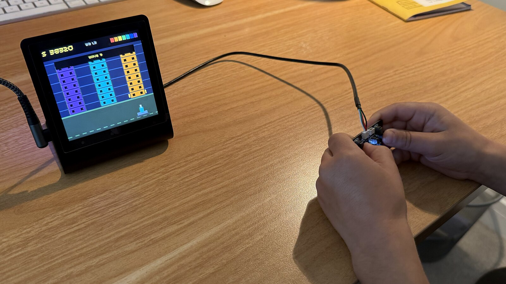

# Pimoroni Presto Arcade

A touch-driven arcade carousel for [Pimoroni Presto](https://shop.pimoroni.com/products/presto),
with every game controlled by a compact [Qw/ST Pad](https://shop.pimoroni.com/products/qwst-pad?variant=53514400596347)
over I2C.



## Games

- **Fly Smash** — auto-bounce through opening clouds and laser flying cars.
- **Ogre Smash!** — smash traffic, leap hazards and chase a high score.
- **Rainbow Barrage** — collapse storm towers with arcing rainbow missiles.
- **Zombie Escape** — collect every gem while escaping pursuing zombies.
- **Frogger** — cross traffic and moving platforms through four themes.
- **Random Maze** — escape increasingly difficult generated mazes.
- **Awesome Game** — dodge falling obstacles and collect treasure.

Full game guides, controls, rules and screenshots live on the
[hosted arcade documentation](https://robmarkcole.github.io/pimoroni-presto-arcade/).
The no-build GitHub Pages source is in [`docs/`](docs/).

## Hardware

### Pimoroni Presto

The arcade runs on a fully assembled Presto with:

- an RP2350B microcontroller;
- a 4-inch, 480 × 480 IPS touchscreen, used as a logical 240 × 240 game display;
- a piezo speaker for game effects;
- seven RGB ambient LEDs;
- a Qw/ST (Qwiic/STEMMA QT) connector for the controller.

See the [official Presto product page](https://shop.pimoroni.com/products/presto)
for the complete specification.

### Pimoroni Qw/ST Pad

The [Qw/ST Pad](https://shop.pimoroni.com/products/qwst-pad?variant=53514400596347)
is a fully assembled I2C controller built around a TCA9555 I/O expander. It
provides:

- eight large buttons labelled `U`, `D`, `L`, `R`, `A`, `B`, `X` and `Y`;
- two smaller `+` and `-` buttons;
- four software-controlled white status LEDs;
- two Qw/ST connectors for easy chaining;
- selectable I2C addresses `0x21`, `0x23`, `0x25` and `0x27`;
- 3V–5V compatibility.

This project uses the default address `0x21` on I2C 0, with SDA on Presto
GPIO 40 and SCL on GPIO 41. The pad connects directly to Presto with a 4-pin
JST-SH Qw/ST cable, with no soldering required. The touchscreen selects games
from the carousel; the Qw/ST Pad handles gameplay. `+` starts or restarts and
`-` returns to the carousel.

## Install

With Presto connected over USB and `mpremote` available:

```sh
mpremote cp main.py awesome_game.py random_maze.py frogger.py ogre_smash.py \
  zombie_escape.py rainbow_barrage.py fly_smash.py :
mpremote reset
```

`awesome_game.py` also needs the two original pirate `.16bpp` sprite sheets
from the Presto demo bundle. The carousel uses an explicit game allowlist, so
other demo scripts can remain on the board without appearing as arcade games.
