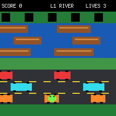
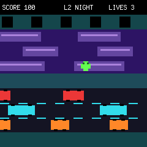
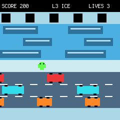
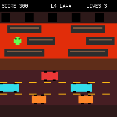

# Pimoroni Presto Arcade

An arcade carousel for the 240 x 240 Pimoroni Presto, controlled with a
QwSTPad on the board's Qw/ST (I2C) connector.

## Games

- **Awesome Game** — dodge falling obstacles and collect treasure.
- **Random Maze** — escape increasingly difficult generated mazes.
- **Frogger** — cross traffic and ride platforms through four progressively
  faster themes: River, Night, Ice, and Lava. Game Over retries the current
  level rather than discarding level progress.
- **Ogre Smash!** — score as many points as possible with three lives by
  jumping lakes, smashing cars for lightning, and blasting traffic.

All games use the QwSTPad at its default address (`0x21`) on I2C 0, with SDA
on pin 40 and SCL on pin 41. Direction buttons move, `+` starts or restarts,
and `-` returns to the carousel.

## Ogre Smash! prototype

Ogre Smash is an endless score attack with three lives. Traffic becomes faster
and more frequent the longer the ogre survives. Smash a nearby car to turn it
into a lightning pickup, collect the bolt to grow stronger, then fire up the
current lane to destroy every car and truck the lightning hits. A looping
chiptune and distinct jump, smash, pickup, lightning, damage, and Game Over
sounds play through Presto's onboard piezo buzzer.

| QwSTPad input | Action |
| --- | --- |
| `L` / `R` | Change lane |
| `U` | Jump over cars and lakes |
| `A` | Smash a nearby normal car |
| `B` | Fire lightning up the current lane when charged |
| `+` | Start or retry |
| `-` | Return to the arcade carousel |

## Frogger

Guide the frog from the grass at the bottom of the screen to the far bank.
Cross three traffic lanes without being hit, then use the moving platforms to
cross three water lanes. Reaching any point on the far bank completes the
level.

### Controls

| QwSTPad input | Action |
| --- | --- |
| D-pad | Move one cell up, down, left, or right |
| `+` | Advance to the next level, retry, or play again |
| `-` | Return to the arcade carousel |

The QwSTPad status LEDs show remaining lives during play. All four illuminate
when a level is complete.

### Rules and scoring

- The frog starts each level with the lives carried over from the previous
  level.
- A collision with traffic, falling in the water, or leaving the screen costs
  one life and returns the frog to the start of the current level.
- Running out of lives shows Game Over. Retrying restores three lives while
  preserving the current level and score.
- Each forward hop scores 10 points.
- Completing a level awards `100 × level` points.
- Completing Lava, the fourth level, wins the game.

### Levels

| Level | Theme | Speed | Description |
| ---: | --- | ---: | --- |
| 1 | River | 1.00× | The baseline road and river crossing. |
| 2 | Night | 1.25× | Darker lanes with faster traffic and platforms. |
| 3 | Ice | 1.55× | Bright frozen colours and a sharper pace. |
| 4 | Lava | 1.90× | The fastest crossing over lava and hot asphalt. |

### Screenshots

| River | Night |
| :---: | :---: |
|  |  |

| Ice | Lava |
| :---: | :---: |
|  |  |

The screenshots use the game's native resolution, geometry, sprites, and
colour palettes. Regenerate them with:

```sh
uv run --with pillow tools/render_frogger_screenshots.py
```

## Install

With Presto connected over USB and `mpremote` available:

```sh
mpremote cp main.py awesome_game.py random_maze.py frogger.py ogre_smash.py :
mpremote reset
```

`awesome_game.py` also needs the two original pirate `.16bpp` sprite sheets
from the Presto demo bundle. The carousel uses an explicit game allowlist, so
other demo scripts can remain on the board without appearing as arcade games.
