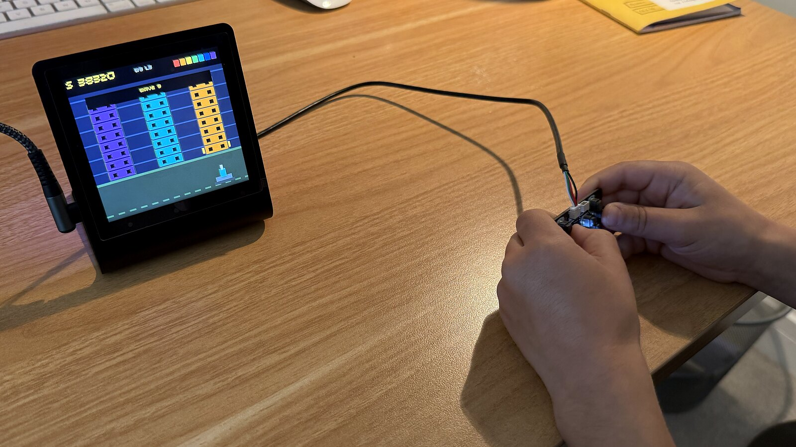

# Pimoroni Presto Arcade

A touch-driven arcade carousel for [Pimoroni Presto](https://shop.pimoroni.com/products/presto),
with every game controlled by a compact [Qw/ST Pad](https://shop.pimoroni.com/products/qwst-pad?variant=53514400596347)
over I2C.



## Games

- **[Road Riot](https://robmarkcole.github.io/pimoroni-presto-arcade/games/road-riot.html)** — automatically accelerate through three motorcycle races, steer around traffic and punch rival riders with the right-hand buttons.
- **[Duck Kart Rally](https://robmarkcole.github.io/pimoroni-presto-arcade/games/duck-kart-rally.html)** — steer a duck kart through boosts, coins and rocky tracks.
- **[Find Your Best Friend](https://robmarkcole.github.io/pimoroni-presto-arcade/games/find-your-best-friend.html)** — catch a monster, search the doors and rescue your friend.
- **[Fly Smash](https://robmarkcole.github.io/pimoroni-presto-arcade/games/fly-smash.html)** — auto-bounce through opening clouds and laser flying cars.
- **[Ogre Smash!](https://robmarkcole.github.io/pimoroni-presto-arcade/games/ogre-smash.html)** — smash traffic, leap hazards and chase a high score.
- **[Rainbow Barrage](https://robmarkcole.github.io/pimoroni-presto-arcade/games/rainbow-barrage.html)** — collapse storm towers with arcing rainbow missiles.
- **[Zombie Escape](https://robmarkcole.github.io/pimoroni-presto-arcade/games/zombie-escape.html)** — collect every gem while escaping pursuing zombies.
- **[Awesome Game](https://robmarkcole.github.io/pimoroni-presto-arcade/games/awesome-game.html)** — dodge falling obstacles and collect treasure.
- **[Random Maze](https://robmarkcole.github.io/pimoroni-presto-arcade/games/random-maze.html)** — escape increasingly difficult generated mazes.
- **[Frogger](https://robmarkcole.github.io/pimoroni-presto-arcade/games/frogger.html)** — cross traffic and moving platforms through four themes.

Full game guides, controls, rules and screenshots live on the
[hosted arcade documentation](https://robmarkcole.github.io/pimoroni-presto-arcade/).
The no-build GitHub Pages source is in [`docs/`](docs/).

## Hardware

### Pimoroni Presto

The arcade runs on a fully assembled Presto with:

- an RP2350B microcontroller;
- a 4-inch, 480 × 480 IPS touchscreen, used as a logical 240 × 240 game display;
- a piezo speaker for game effects;
- seven RGB ambient LEDs;
- a Qw/ST (Qwiic/STEMMA QT) connector for the controller.

See the [official Presto product page](https://shop.pimoroni.com/products/presto)
for the complete specification.

### Pimoroni Qw/ST Pad

The [Qw/ST Pad](https://shop.pimoroni.com/products/qwst-pad?variant=53514400596347)
is a fully assembled I2C controller built around a TCA9555 I/O expander. It
provides:

- eight large buttons labelled `U`, `D`, `L`, `R`, `A`, `B`, `X` and `Y`;
- two smaller `+` and `-` buttons;
- four software-controlled white status LEDs;
- two Qw/ST connectors for easy chaining;
- selectable I2C addresses `0x21`, `0x23`, `0x25` and `0x27`;
- 3V–5V compatibility.

This project uses the default address `0x21` on I2C 0, with SDA on Presto
GPIO 40 and SCL on GPIO 41. The pad connects directly to Presto with a 4-pin
JST-SH Qw/ST cable, with no soldering required. The touchscreen selects games
from the carousel; the Qw/ST Pad handles gameplay. `+` starts or restarts and
`-` returns to the carousel.

## Install

Use the [official Presto MicroPython firmware](https://github.com/pimoroni/presto/releases/latest).
The `-with-filesystem` bundle includes the carousel's
`Roboto-Medium-With-Material-Symbols.af` font and the pirate sprites used by
Awesome Game. With Presto connected over USB and `mpremote` available:

```sh
mpremote cp main.py road_riot.py awesome_game.py random_maze.py frogger.py ogre_smash.py \
  zombie_escape.py rainbow_barrage.py fly_smash.py find_your_best_friend.py \
  duck_kart_rally.py :
mpremote reset
```

`awesome_game.py` also needs the two original pirate `.16bpp` sprite sheets
from the Presto demo bundle. The carousel uses an explicit game allowlist, so
other demo scripts can remain on the board without appearing as arcade games.

### Road Riot controls

The bike accelerates automatically after the countdown, so you can focus on
steering with the left keypad and punching with the right keypad.

| Button | Action |
| --- | --- |
| `L` / `R` | Steer left / right |
| `Y` / `A` | Punch left / right |
| `B` or `D` | Brake; release to accelerate again |
| `U` | Boost; release after emptying the tank before boosting again |
| `+` | Start, pause, resume or continue |
| `-` | Return to the arcade |

Tap and release each punch button for another attack. Two hits knock a rival
down temporarily and restore some boost. Finish in the top three to advance
through Sunset Strip, Canyon Run and Midnight Coast. Avoid cars, oil and the
verges to protect your bike; the pad LEDs show its remaining condition.
Scores carry between qualifying courses, and your best score survives resets.
Road Riot uses original procedural graphics and needs no external game assets.

### Road Riot development checks

Run the gameplay checks with `python3 tools/check_road_riot.py`. Regenerate the
documentation previews with
`uv run --with pillow python tools/check_road_riot.py --render`.
The previews use the game's drawing functions with a substitute host font.
